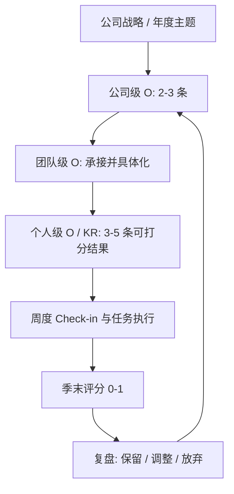

# 目标与关键结果（OKR, Objectives and Key Results）

2025200385 陈悦杰

---

## 一、定义：什么是 OKR

OKR 是 Objectives and Key Results 的缩写，中文一般译作"目标与关键结果"。它是一套目标管理方法，核心结构包括以下两个方面：

- **O（Objective，目标是定性的）**：说明本季度最希望改变什么、推动到哪里。表述需要有方向感与感召力，但不可直接验收。
- **KR（Key Result，关键结果是定量的）**：说明如何证明上述目标确实发生，一般以数字、时间节点或明确的交付物形式呈现。

两者配套使用，通常在一个 O 之下设置 3-5 条 KR。O 用于明确方向、形成共识，KR 用于提供可衡量的刻度，并作为季度末评分的依据。

**O 的写法：** 一句话写成"让〔某对象〕〔发生什么方向性变化〕"，**不写指标数值，不写完成判定**。

**KR 的写法：** 必须写清三件事——**基线**（从多少出发）、**期限**（到什么时候为止）、**口径**（怎么算、数据取自哪里）。缺任何一项，季末都会变成各说各话。

举例：

> **O：让"社交媒体分析"模块成为团队做选题决策的第一参考工具。**
>
> - KR1（结果型·承诺型）：季度内选题会上引用该模块结论的比例，由 25% 提升到 70%；
> - KR2（结果型·承诺型）：模块内 KPI 分析类需求的平均交付周期，由 12 天缩短到 5 天；
> - KR3（逆向结果型·承诺型）：该模块需求上线后 14 天内的返工率，由 15% 降至 5% 以下。

该例中有两点需要注意。其一，O 本身不含具体数值，其作用在于确定基调，若强行加入指标，则容易退化为一句口号。其二，KR 写的是"发生了什么变化"而不是"做了什么动作"——"提升团队的数据意识"无法验证，季末只能依赖主观判断。

另有一个常见误解需要澄清：**KR 并非任务清单**。"上线 CRM 系统""完成 3 个版本发布"属于任务，而非 KR。本报告统一使用一条判别方法：**若相应工作已经完成，而对应指标没有变化，此时这条 KR 是否仍算完成？若算，它描述的仍是任务，不是结果。** 后文 3.2 节的产出型条目、第五章的对比分析均按这条规则处理。

---

## 二、背景与上下文

### 2.1 发展脉络

OKR 起源于**英特尔（Intel）**。Robert Noyce 与 Gordon Moore 于 1968 年 7 月 18 日注册成立公司，Andy Grove 随后加入共同领导（来源见参考文献 [3]）。

20 世纪 70 年代，格鲁夫在英特尔推动引入彼得·德鲁克的目标管理（MBO）。德鲁克的 MBO 指标偏财务、逐层下发（来源见参考文献 [4]），并未回答"公司究竟要成为什么"。格鲁夫对此提出过一个著名问题：**"如果我们被赶出董事会，换一个新 CEO 进来，他会做什么决定？"**（该提问出自其 1996 年回忆录，来源见参考文献 [5]）。这一问促使英特尔把目标聚焦到方向性判断上，形成 iMBO（英特尔版目标管理），即 OKR 的雏形。

1999 年加入 Google 的 John Doerr 把这一做法带进 Google，公开命名为 Objectives and Key Results。公司内部用 **re:Work**（Google 的目标与绩效管理平台）承载这套流程，方法论通过官方指南 *re:Work Guide: Set Goals with OKRs* 公开；该指南早期以 *A Guide to OKRs* 之名发布，因此国内文献多引后一个名字（来源见参考文献 [1]）。指南确立的操作范式是：季度制定、周度 check-in、季末按 0-1 打分，0.7 视为目标达成、1.0 视为挑战性目标达成。Intel、Amazon、Meta 等公司均有公开实践。

国内真正流行是 2019 年前后。几本管理类的书把方法和工具流程讲清楚（来源见参考文献 [6]），加上飞书、企业微信这些平台把 OKR 做成线上功能，很多公司才开始按"周会更新 + 月度复盘 + 季度评分"跑起来。

近几年国内实践又出现几个新变化，值得补充说明：

**一是 OKR 与 KPI 融合，形成 MOKR 模式。** 纯粹按 re:Work 官方指南打分的企业相对有限，多数国内企业选择把 OKR 嵌入既有的绩效体系：用 O 承接部门责任，用 KR 中的量化条目充当考核指标，两套工具合用（MOKR，Objectives and Key Results and Measures）在国内互联网与制造业企业中被广泛采用。需要说明的是，MOKR 不是 Google 的官方体系，而是国内实践的自行命名与变体。

**二是周期缩短与"轻量化"。** 除季度 OKR 外，部分企业开始试行月度甚至双周 OKR，配合敏捷迭代使用，工具形态从"季度考核表"变成"看板上的进度条"。

**三是工具平台化。** 飞书 OKR、企业微信、钉钉、Teambition、Worktile 等产品把 KR 进度更新、周会提醒、评分统计做成现成功能，员工不必自行维护文档，OKR 因此更容易在中小企业落地。

**四是与 AI、敏捷研发等新方法结合。** 2023 年以来生成式 AI 普及，模型效果、迭代速度这类指标难以事先设定目标，于是一些团队改用"方向性 O + 每周实验性 KR"的方式管理 AI 项目，OKR 的 KR 由固定承诺转向可调整的实验指标。

需要指出的是，OKR 在国内的热度与 HR SaaS 厂商的推动密不可分，公开材料中带有较强的宣传色彩；本文提出一条经验性判据：判断一家企业是否真正落地 OKR，不妨看它是否留存了季度评分记录与复盘文档。这一判据是本文的经验总结，不是官方标准。

### 2.2 OKR 的现实价值

**其一是缓解目标稀释。** 一个团队一个季度手中常有二三十项待办事项，却往往缺乏排序。OKR 要求一个周期只选定 3-5 个关键结果，迫使团队作出取舍——被舍弃的部分往往比被保留的部分更能说明该季度的重点。

**其二是区分工作投入与工作成果。** 传统汇报常以"本季度完成 18 项任务"说明价值，而 OKR 要求逐条对照"KR 是否达到目标值"说明价值。前者衡量投入强度，后者衡量实际成果。

**其三是为跨部门协作提供共同坐标。** 公司级 O 逐层拆解为团队级 O 与个人级 KR，拆解过程中必须能够说明本条 KR 支撑的是上层哪一条 KR；若无法追溯，通常意味着该 KR 价值有限，或上层目标表述不清。

### 2.3 适用边界与局限

| 场景 | 说明 |
| --- | --- |
| 方向已经清晰，剩余工作为稳定交付 | 客服、运维、合规等岗位，OKR 所强调的挑战性易与流程稳定性要求相冲突 |
| 结果需较长周期方能显现 | 基础研究、大型基建工程等，一个季度内难以观察到变化，评分易失真 |
| 薪酬已直接与工时或计件挂钩 | 考核维度已经覆盖，再引入目标评分属重复考核 |

---

## 三、深入扩展：OKR 的内部逻辑与运作机制

### 3.1 好目标的写法（Objective）

一个好目标应当满足"**定性 + 有张力 + 可感召**"。三条自检问题：能否回答"达成了会改变什么"；季末能否判断方向是否被推动（而不是指标是否达标）；是否不含百分比与"完成 N 次"这类可验收数字。

| 反模式（把 O 写成 KR 或口号） | 改进写法 |
| --- | --- |
| 完成 12 次培训 | 让新员工能独立完成一次投放复盘（是否通过写入 KR） |
| 上线 CRM 系统 | 让销售线索的分配与跟进不再依赖微信群 |
| 把崩溃率降到 0.3% 以下 | 让核心模块的线上事故在当周内定位并闭环 |

左列中的数字不是 KR 的内容，而是被错误写进 O 的验收条件——一旦写进去，O 就退化成了 KR，团队会围着指标谈判而失去方向讨论。

### 3.2 关键结果的四种类型

关键结果按"衡量对象"与"变化时点"两个维度可分为四类，实际使用时可对照下表判断：

| 类型 | 衡量对象 | 示例 | 优势 | 局限 |
| --- | --- | --- | --- | --- |
| 产出型（Output） | 可交付的成果，附带"由谁在什么场景使用" | 季度内上线 8 个分析模板，其中至少 6 个被用于实际分析报告 | 进度可控、验收清晰 | 若只写"做完什么"而不写"被谁使用"，按第一章的判别方法即退回为任务 |
| 结果型（Outcome） | 业务指标的实际变化 | 付费转化率由 2.1% 提升到 3.0% | 直接体现价值 | 归因困难，易受外部因素干扰 |
| 领先型（Leading） | 对结果有预测作用的先行指标 | 新增用户 7 日留存率由 31% 提升到 38% | 出现较早，便于及时纠偏 | 与最终结果的相关性需验证 |
| 滞后型（Lagging） | 滞后显现的财务或规模指标 | 年度营收、总 GMV | 权威、可对外披露 | 反馈过慢，季中期难以判断走向 |

三类补充说明。其一，四类不是互斥标签，同一条 KR 可能兼有产出与结果属性，按其验收口径归类即可。其二，无论哪一类，都必须写明基线值、期限与统计口径。其三，产出型 KR 是唯一容易滑向任务清单的类型，因此必须补上"被谁使用、在什么场景下使用"这一半。

实践建议：**每个 O 至少配置 1 条结果型 KR**，否则 OKR 容易退化为项目计划表。

### 3.3 KR 的目标强度：承诺型与挑战型

同一条 KR 写完，还需标明它属于哪一档强度，否则季末必然争议：

| 类型 | 含义 | 未达标意味着什么 | 季末处理 |
| --- | --- | --- | --- |
| 承诺型（Committed） | 团队有把握完成，不完成会暴露真实问题 | 出现偏差，需要说明原因与补救动作 | 记未完成，进入复盘 |
| 挑战型（Stretch / Aspirational） | 有价值但无把握，通常在基线外推之外再加幅度 | 假设未成立，不等于工作失败 | 记未达成，但必须记录学到了什么 |

两档的划分标准由团队自行决定，re:Work 官方指南只鼓励设定挑战性目标，并未给出统一的划分方法（见参考文献 [1]）。因此划分必须在季度开始前完成，并写进 OKR 文档本身。常见的一种约定是给挑战型 KR 设置计分上限；本文 4.4 节的示例组三条均为承诺型，故 4.5 节的计算不涉及该上限。

### 3.4 评分机制与档位

官方指南给出的只有**刻度与档位，没有计算公式**（来源见参考文献 [1]）：季末按 0-1 打分（写成 0-100 与之等价），0.7 视为目标达成，1.0 视为挑战性目标达成。指南同时明确评分用于对齐与复盘，并建议不要把 OKR 评分直接当作绩效评级或奖金换算依据。

下列折算式**不是 Google 的规定，而是团队需要事先约定的示例口径**。约定内容至少包括折算方式、权重、挑战型上限三项，且必须在季度开始前写入文档，季末不得临时更改。

**正向 KR（越大越好，如留存率、收入、交付量）：**

$r_i = \min\left(1, \frac{x_i}{T_i}\right)$

其中 $T_i$ 为目标值、$x_i$ 为实际完成值、$r_i$ 为该条 KR 的完成度。上限截断为 1，是为了避免超额完成带来"过度激励"，例如为拿高分而超额压低成本。

**逆向 KR（越小越好，如缺陷率、返工率、成本、流失率）：**

$r_i = \mathrm{clip}\left(0.7 + 0.3 \cdot \frac{T_i - x_i}{T_i},\, 0,\, 1\right)$

其中 $\mathrm{clip}(a, 0, 1)$ 表示把结果限制在 0 至 1 之间。该式是本文"逆向 KR 达标记 0.7 分、问题完全清零记 1.0 分"这一约定的数学写法：$x_i = 0$ 记 1.0，$x_i = T_i$ 记 0.7，未达标则按超出目标值的幅度线性扣减。另一常见约定是按改善比例线性折算（$r_i = \mathrm{clip}((x_0 - x_i)/(x_0 - T_i), 0, 1)$，其中 $x_0$ 为基线值），两种约定都属团队自选，关键是季中不得更换。

**这里必须指出一个口径不对称的问题：** 同一季度内，正向 KR 刚好达标（$x_i = T_i$）记 1.0 分，而逆向 KR 刚好达标记 0.7 分。因此把两类 KR 混合加权得到的总分，不能单独用来判断"整体是否达标"——加权值受权重分配影响很大，且没有跨团队可比性。达标与否应逐条对照 $x_i$ 与 $T_i$ 判定，加权总分只用于同一条 OKR 内部的横向比较。

**加权总分（各 KR 重要性不同）：**

$R = \sum_{i=1}^{n} w_i r_i$，其中权重满足 $\sum_{i=1}^{n} w_i = 1$ 且 $w_i > 0$，具体权重由团队自行确定。

**参考档位（源自 re:Work 官方指南）：**

| 分数 | 指南中的含义 |
| --- | --- |
| 1.0 | 挑战性目标达成（stretch success） |
| 0.7 | 目标达成（success） |
| 0.3 - 0.6 | 有实质进展但未达成 |
| 0 - 0.2 | 基本无进展 |

档位是复盘时的沟通语汇，Google 未公开把原始数据换算成分数的公式。团队若采用上述折算约定，应在文档中写明一句："本表仅为参考语汇，最终以逐条 KR 是否达到 $T_i$ 判定。"

**过程信号：check-in 记录是否齐备。** 官方指南要求周会更新 KR 进度，但**未给出打卡率的达标阈值**；不同团队的会议节奏差异过大，本文不设统一百分比阈值。实践中可改为使用检查清单：每条 KR 每周是否被更新、阻塞项是否被提出、KR 定义变更是否留痕。

### 3.5 节奏（Cadence）

| 频次 | 动作 | 责任人 |
| --- | --- | --- |
| 周（30-60 分钟） | Check-in：更新 KR 进度 0-1、红黄绿状态、提出阻塞项 | 直接下属汇报，上级只提问不点评 |
| 双周/月 | 复盘：看趋势与依赖关系，必要时微调 KR 定义（允许"改目标"） | 团队负责人 |
| 季末 | 评分：0-1 打分、对齐评级、提炼经验并写入"我们的经验"文档 | 上级 + 同事互评 |
| 季初 | 制定：自下而上起草 → 与上级/相关团队对齐 → 公开承诺 | 全员 |

**注意**：OKR 的评分在多数公司**不直接等同于奖金**。即便部分公司把 KR 得分纳入绩效，也需事先约定换算方式与上限，各家做法差异很大，本文不给出具体比例。这正是 OKR 敢设挑战型目标的前提——评分用于复盘和学习，不用于惩罚。

### 3.6 从战略到执行的链路

关键机制：**对齐（Alignment）**。团队级 KR 必须能追溯到上层 KR；如果无法追溯，说明要么该 KR 价值低，要么上层目标描述不清。

---

## 四、举例说明

### 4.1 真实案例一：Intel——"如果被换掉的董事会"如何变成一个战略决策

**英特尔成立于 1968 年**（Robert Noyce 与 Gordon Moore 于 1968 年 7 月 18 日注册成立，见参考文献 [3]），成立初期以存储器芯片为主业，此后业绩一路下滑。1985 年，Andy Grove 提出那个著名的问题：**如果我们被赶出董事会，换一个新 CEO 进来，他会做什么决定？** 提问的原始表述出自 Grove 1996 年的回忆录 *Only the Paranoid Survive*（见参考文献 [5]）。答案是显而易见的：存储器业务不会得到批准。此后公司把资源集中到微处理器业务，走向后来的主导地位。

这个案例说明 OKR 最初的用途：**它首先是战略判断工具，而不是考核工具。** O 提出的问题（我们要成为什么）与 KR 提供的证据（哪些业务应当被放弃）服务于重大取舍，与个人绩效无关。

### 4.2 真实案例二：Google re:Work 官方指南中的标准做法

Google 的做法以官方指南 *re:Work Guide: Set Goals with OKRs* 公开（早期版本以 *A Guide to OKRs* 之名发布）。其中与本报告直接相关的要点有四条（见参考文献 [1]）：

1. O 写方向，KR 写可衡量的结果，一个 O 下通常配 3-5 条 KR；
2. 季度制定、周度 check-in 更新进度、季末按 0-1 打分；
3. 0.7 视为目标达成，1.0 视为挑战性目标达成；
4. 评分用于对齐与复盘，指南建议不要把 OKR 评分直接与绩效评级或薪酬挂钩。

指南的示例以"进入新市场"为主题，用月活用户数、品牌认知度调查、新增本地渠道合作伙伴等可量化 KR 支撑同一个 O，体现了"O 是方向判断而非数字、KR 全部可量化、KR 不用于发放奖金"三点。本报告不转述该示例的具体数值，引用时请以指南原文为准；本报告全文只使用 4.4 节的自建示例组。

### 4.3 真实案例三：Netflix——没有 OKR 评分体系，却实现了更彻底的对齐

Netflix 自 2009 年前后起在内部推行**季度策略文档（Strategy Doc）**：每季度由团队撰写约十余页文档，说明本季度最重要的几件事、明确"本季度不做什么"，并附上详细的财务测算与情景分析（若某项假设成立会怎样）。文档向全员开放，并举办有高层参加的"战略沟通会"进行讲解；这一做法在 Netflix 技术博客的开篇文章中有公开说明（见参考文献 [7]）。

Netflix 并不以 OKR 分数考核员工，其公开表述也强调"不要把人当成记分卡"。但从功能上看，季度策略文档承担的正是 OKR 的**对齐与聚焦**职能。这一对比恰好印证了本章第六节的判断：**对齐与评价本可分开，多数组织的问题不在于缺少 OKR，而在于把二者混为一谈。**

### 4.4 唯一示例组：一组写清了基线、期限与口径的 OKR

以下是**本报告全文唯一使用的 OKR 示例组**。它为教学示例，数据为示例设定，用于说明一条合格 KR 必须写清的三件事：**基线**（从多少出发）、**期限**（到什么时候为止）、**口径**（怎么算、数据取自哪里）。第一章只列了它的摘要，此处给出完整写法。

> **O：让"社交媒体分析"模块成为团队做选题决策的第一参考工具。**

| KR | 类型·目标强度 | 基线 | 期限 | 统计口径 |
| --- | --- | --- | --- | --- |
| KR1 选题会上引用该模块结论的比例 | 结果型·承诺型 | 25%（上一季度 16 次选题会中 4 次） | 2026-12-31 前达到 70% | 逐次会议纪要中标注引用该模块输出的场次 ÷ 当季选题会场次 |
| KR2 KPI 分析类需求的平均交付周期 | 结果型·承诺型 | 12 天（近两个季度均值） | 2026-12-31 前降至 5 天 | 需求确认到上线验收的自然日均值，范围为当季进入该队列并完成的全部需求 |
| KR3 该模块需求的 14 天返工率 | 逆向结果型·承诺型 | 15%（近两个季度均值） | 2026-12-31 前降至 5% 以下 | 上线后 14 天内因口径或数据错误被打回、回滚的需求数 ÷ 当季上线需求数 |

三者缺一不可：没有基线，季末无法判断改善幅度；没有期限，无法确定何时结算；没有口径，"引用""交付周期""返工"在不同人手里会算出不同结果。另外要注意方向性：KR1 越大越好，KR2 与 KR3 越小越好，属逆向指标，评分折算方式与正向 KR 不同（见 3.4 节）。

与模糊表述的差别如下：

| 改写前（不可验收） | 改写后（可验收） |
| --- | --- |
| 把社交媒体分析模块做成做决策的第一参考 | O 采用第一章的句式：让〔对象〕〔发生方向性变化〕，对应 KR1 |
| 多做分析功能 | 落成可计时的交付结果，即 KR2 |
| 提升模块质量 | 落成可统计的返工率，即 KR3 |

**写法要点**：不写"提高影响力/提升质量"，而写"谁在什么场景下做了什么、指标如何变化"。影响力属于他人的印象，难以衡量；引用次数、交付天数、返工率均可计数。同理，"让用户更满意"应落到"满意度评分从 4.1 提升到 4.6"并写明问卷与样本口径；"提高响应速度"应落到"工单首次响应时长从 8 小时降至 2 小时以内"，并写明计时起止点。

### 4.5 教学示例：按事先约定的口径计算得分

沿用 4.4 的示例组。假设该团队在季度开始前已按 3.4 节写明约定：正向 KR（越大越好）用 $\min(1, x_i/T_i)$、逆向 KR（越小越好）用"0.7 起扣"折算，权重为 KR1 取 0.4、KR2 取 0.3、KR3 取 0.3（本组三条均为承诺型，故不涉及挑战型计分上限）。

| KR | 方向 | 权重 $w_i$ | 目标值 $T_i$ | 实际值 $x_i$ | 完成度 $r_i$ |
| --- | --- | --- | --- | --- | --- |
| KR1 引用比例 | 正向 | 0.4 | 70% | 63% | $\min(1, 63/70) = 0.90$ |
| KR2 交付周期 | 逆向 | 0.3 | 5 天 | 6 天 | $0.7 + 0.3 \times \frac{5 - 6}{5} = 0.64$ |
| KR3 返工率 | 逆向 | 0.3 | 5% | 6% | $0.7 + 0.3 \times \frac{5 - 6}{5} = 0.64$ |

$R = 0.4 \times 0.90 + 0.3 \times 0.64 + 0.3 \times 0.64 = 0.744$

**这个 0.744 不能被解读为"整体达标"。** 三点原因：其一，正向与逆向 KR 的达标口径不对称（逆向达标记 0.7，正向达标记 1.0），混合加权后的数值取决于权重怎么分，换一组权重结论就变——例如把权重全给 KR1，$R$ 就是 0.90；其二，官方指南的 0.7/1.0 是复盘语汇，不是加权分的换算标准；其三，本组三条 KR 都是效率与质量类指标，缺少能反映业务价值的结果型 KR，加权分再高也不能证明目标达成。

正确的读法是逐条对照目标值：KR1（63% < 70%）未达标，KR2（6 天 > 5 天）未达标，KR3（6% > 5%）未达标。于是出现一个很有说明力的反差：**加权分 0.744 已越过 0.7 这个常用语汇，但三条 KR 全部未达成。** 本季度的结论应为"三条承诺型 KR 均未达成"，动作是逐条追溯原因，而不是宣布"团队打了 0.744 分"。

补充说明：本组三条 KR 都是效率与质量类指标，若照搬执行，容易退化为产品团队的内部考核表；改进办法是补一条结果型 KR，例如"由该模块结论直接带来的选题播放量提升 15%"，并同样写清基线、期限与口径。

---

## 五、对比分析：OKR 与相似概念的区别

| 维度 | OKR | KPI | MBO（目标管理） | BSC（平衡计分卡） | 项目/任务清单 |
| --- | --- | --- | --- | --- | --- |
| 本质 | 战略沟通与聚焦工具 | 考核指标体系 | 目标设定方法论 | 战略因果框架 + 考核工具 | 执行调度工具 |
| 数量 | 每周期 3-5 个 | 5-20 个指标 | 若干 | 4 维度数十个 | 不限 |
| 是否量化 | KR 必须量化 | 必须量化 | 部分量化 | 必须量化 | 不要求 |
| 性质 | 定性目标 + 定量结果 | 全部定量 | 偏定量 | 全部定量 | 定性描述为主 |
| 时间跨度 | 1 个季度（可延长） | 月/季/年 | 1 年 | 1-5 年 | 天/周 |
| 与考核挂钩 | 部分公司轻挂钩 | 通常强挂钩 | 强挂钩 | 强挂钩 | 通常不挂钩 |
| 目标是否"可拉伸" | 鼓励 stretch（挑战性） | 一般"够得着" | 一般可达 | 可拉伸 | 视任务而定 |
| 失败代价 | 低（重在对齐与学习） | 高（直接影响奖金） | 高 | 高 | 低 |

**几个最容易混淆的点：**

1. **OKR ≠ KPI。** KPI 是"衡量公司健康度的仪表盘读数"，追求稳定与可控；OKR 的 KR 是"本季度要推动的刻度"，追求挑战与突破。实践中常把 KR 做成 KPI 形态，于是"设为挑战性目标"变成口号。
2. **OKR ≠ 任务清单。** "完成 3 个版本发布"是任务；"把崩溃率从 1.2% 降到 0.3% 以下并连续 8 周保持"是 KR。判别方法与第一章一致：**若工作做完了而指标没变，KR 却仍算完成，它描述的仍是任务。** 3.2 节的产出型 KR 是唯一需要特别小心的一类，必须补上"被谁在什么场景使用"。
3. **OKR ≠ 战略。** 战略回答"我们为什么赢"（方向选择），OKR 回答"这个季度如何在某一维度上可验证地推进"（路径与刻度）。一份战略可以支撑多个季度的 OKR。
4. **OKR ≠ "目标"。** 企业常有目标体系（如北极星指标），OKR 是实现目标的**季度落地机制**：目标回答"最终要什么"，KR 回答"本季度交什么结果才算数"。

---

## 六、小结

OKR 由定性的目标与定量的关键结果两部分构成，通过"一个周期只做 3-5 个关键结果"解决目标稀释问题。O 写方向、不写指标数值；KR 写结果，并同时标明基线、期限与统计口径。季末按 0-1 打分，其中 0.7 为目标达成、1.0 为挑战性目标达成；至于单条 KR 如何换算成分数，官方指南只给刻度而未给公式，需由团队在季度开始前事先约定折算方式、权重以及承诺型与挑战型的处理规则，并保证季末不临时更改。过程上以周度 check-in 维持记录齐备。相较 KPI 与 BSC，OKR 的重心不在考核而在聚焦与对齐：它回答的是"这个季度把力气放在哪里"，而不是"某个人值多少"。

这一区别也决定了它的局限。一旦将 KR 得分与奖金直接挂钩，指标的博弈风险随之上升：拆分难度、替换代理指标、刷高可量化的数字，都会使得分偏离真实进展（Goodhart 定律，见参考文献 [10]）；团队成果本就受上级决策、跨部门配合与外部环境影响，难以归因到个人，运气与判断力也无法区分；基础研究、平台维护等难以量化的工作则会被系统性挤压，季度节奏还会诱导组织把资源从长期投入移向当期指标。目标设定研究同样表明，具体而有难度的目标仅对简单、可量化、路径明确的任务有效，对复杂与创造性任务效果减弱，甚至因数据造假与目标窄化带来负面后果（见参考文献 [8][9]）。因此较为稳妥的做法是：由 OKR 承担对齐与牵引功能，绩效判断交由校准会议、行为锚定评价、持续绩效管理等独立机制承担，KR 数据至多作为参考项，而不作为奖金换算依据。

---

## 参考文献与资料来源

[1] Google re:Work. *re:Work Guide: Set Goals with OKRs*https://rework.withgoogle.com/okrs-guide/set-goals-with-okrs 。本报告关于"O 写方向、KR 可衡量、3-5 条 KR、季度制定与周度 check-in、0-1 打分、0.7 为目标达成、1.0 为挑战性目标达成、评分不与薪酬挂钩"的表述均以此为准；该指南未公开把数据换算为分数的公式，也未给出打卡率阈值。

[2] Doerr, J. *Measure What Matters: How Google's Billions of Dollars and Billions of Google Employees Solve the World's Toughest Problems*. Crown Business, 2018.

[3] Intel Corporation. *Explore Intel's History*。https://timeline.intel.com/ 

[4] Drucker, P. F. *The Practice of Management*. Harper & Brothers, 1954.

[5] Grove, A. S. *Only the Paranoid Survive: An Extraordinary Man and His Mission to Solve Intel's Crisis*. Crown Business, 1996.

[6]姚琼. 《这就是 OKR》与《OKR 使用手册》，中信出版社，2019。

[7] Netflix Technology Blog. *Flailing on the Way to Victory: A New Netflix Technology Blog Series*, 2016.

[8] Ordóñez, A.; Schneider, M. C.; Rees, M. S.; Perry, J. L. "Goals Gone Wild: Diagnosing, Treating, and Preventing Goal Dysfunction." *Academy of Management Perspectives*, 23(1), 2009, pp. 17-48.

[9] Locke, E. A.; Latham, G. P. "Building a Practically Useful Theory of Goal Setting and Task Motivation: A 35-Year Odyssey." *American Psychologist*, 57(9), 2002, pp. 705-717.

[10] Strathern, M. *Accounting Transformed: Uber Econometrics and the Fall of Institutional Trust*. Routledge, 1997.

[11] Kaplan, R. S.; Norton, D. P. *The Balanced Scorecard*. Harvard Business School Press, 1996.

---

## 附：术语中英对照

| 缩写 | 英文 | 中文 |
| --- | --- | --- |
| O | Objective | 目标 |
| KR | Key Result | 关键结果 |
| KOI / KPI | Key Objective Indicator / Key Performance Indicator | 关键目标/绩效指标 |
| Check-in | Check-in | 定期进度更新（周会打卡） |
| Alignment | Alignment | 上下级/跨团队对齐 |
| Committed / Stretch Goal | Committed / Stretch Goal | 承诺型 / 挑战性目标 |
| Cadence | Cadence | 运营节奏（周/月/季） |
| Retrospective | Retrospective | 复盘 |
